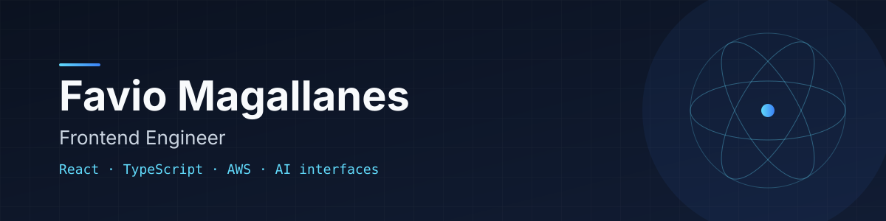

Frontend Engineer con más de 5 años desarrollando aplicaciones con **React** y **TypeScript**. Me enfoco en componentes modulares y mantenibles, buen rendimiento y, cada vez más, en interfaces para productos con IA: respuestas en streaming, manejo de contexto y UX que genera confianza frente a resultados no deterministas.

Escribo sobre código limpio, arquitectura de componentes y UX para IA en [LinkedIn](https://www.linkedin.com/in/favio-magallanes/).

📍 Buenos Aires, Argentina

---

### Proyectos destacados

| Proyecto | Descripción | Stack |
| --- | --- | --- |
| [**Commit & Ship**](https://github.com/FavioMagallanes/commit-and-ship) · [demo](https://commit-and-ship.vercel.app/) | Agregador de novedades tech (Hacker News, GitHub, dev.to, Mastodon) sin cuentas ni algoritmos de recomendación. | TypeScript · APIs públicas |
| [**Margen**](https://github.com/FavioMagallanes/margen) · [demo](https://margen-ashen.vercel.app) | Presupuesto mensual personal: cuotas, préstamos y gastos en ARS y USD. | TypeScript · React |
| [**Gastly**](https://github.com/FavioMagallanes/gastly) · [demo](https://gastly-delta.vercel.app) | Control de gastos con autenticación, cierre mensual y exportación a PDF. | React · TypeScript · Supabase |

---

### Stack

**Frontend** · React, Next.js, TypeScript, Tailwind CSS, shadcn/ui, MUI, Styled Components
**Estado y datos** · TanStack Query, Zustand, Redux
**IA** · Vercel AI SDK, OpenAI, LangChain
**Cloud y backend** · AWS, Python, FastAPI, Supabase
**Diseño** · Figma

---

### Contacto

[LinkedIn](https://www.linkedin.com/in/favio-magallanes/) · [faviomagallanes9@gmail.com](mailto:faviomagallanes9@gmail.com)
